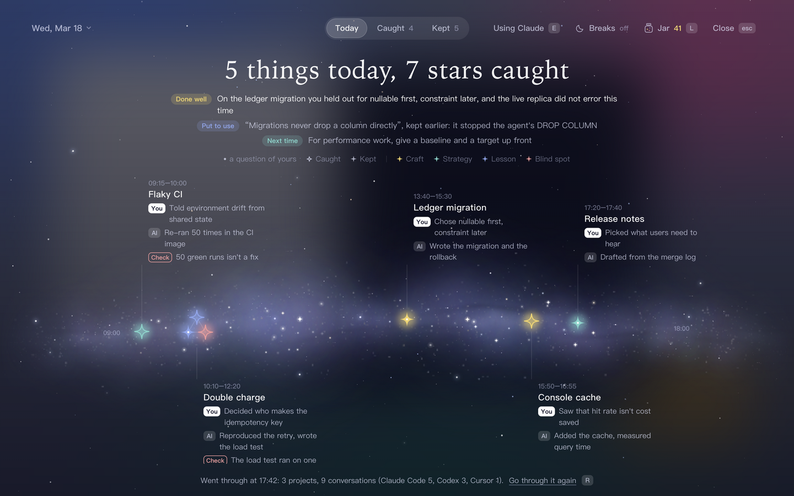
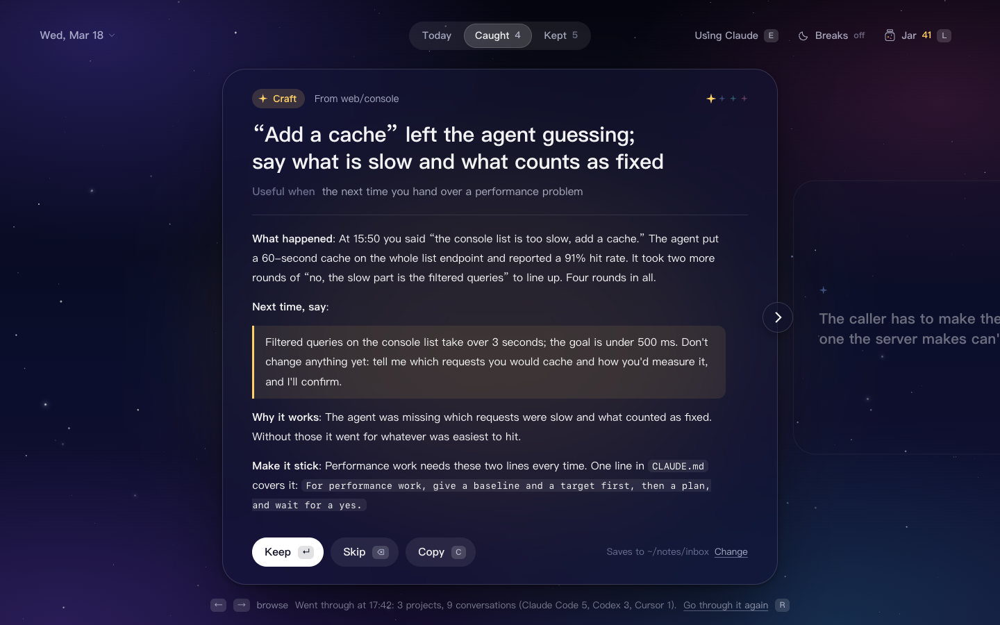
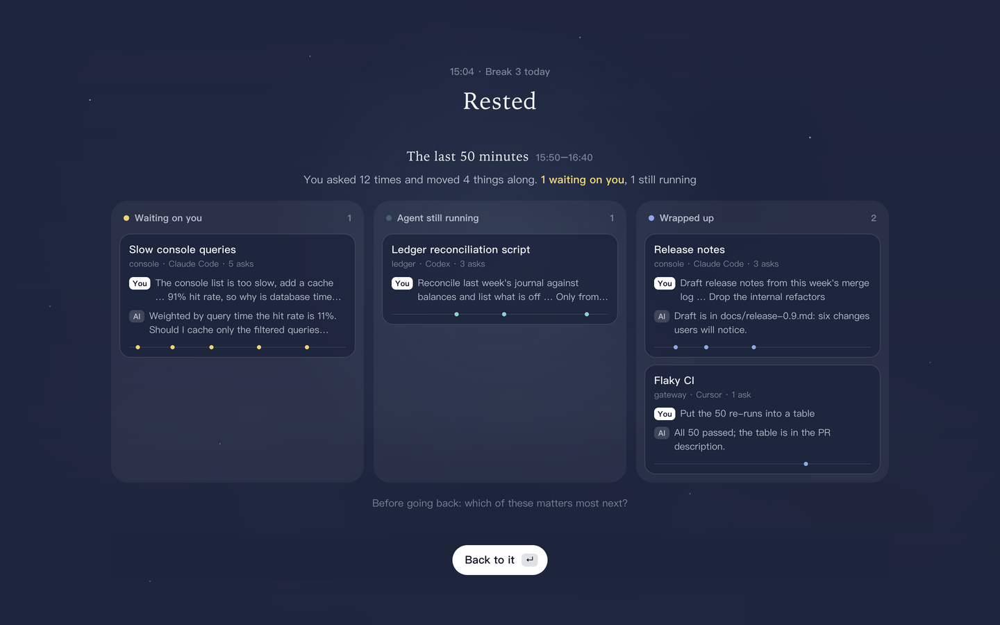

# dotjar

[中文](README.md) | English

After a day of working with AI agents, dotjar lays the day out as a river of stars: it shows where you could have worked with the agent more smoothly, and brings up the strategies, lessons and blind spots worth keeping, one star at a time, into a jar.



## Run it

```bash
npx github:yx0716/dotjar
```

Needs Node 20 or newer, nothing else, and no account. The page opens in your browser; the server listens on `127.0.0.1` only. To see what it looks like without reading anything from your machine:

```bash
npx github:yx0716/dotjar demo
```

## Three things it gives you

- **Craft**: it points at the sentence in today's conversations that left the agent guessing and cost you rounds, and gives you wording you can use as is next time.
- **What the work taught**: judgement that carries to the next project, in three kinds: a way of going at a kind of problem (strategy), a judgement the work earned (lesson), a case that is easy to leave out (blind spot). One card at a time, keep or skip; what you keep is plain Markdown.
- **How you are getting on**: one specific thing you did well today, which earlier keeper you put to use, and how many stars the jar holds by now.



## Breaks

It can ask you to step away for a few minutes every so often. Off by default; you set how often. As the break runs out it shows what you and the agents did in the stretch before it: what an agent is still running, what is waiting on you, what is wrapped up. A busy day no longer ends with nothing to say for it.



## What it reads, and who reads it

The conversation records on this machine from Claude Code, Codex, Cursor, Gemini CLI, Qwen Code, opencode, OpenClaw and others: only what you said and each turn's closing message, never uploaded. The day is gone through by your local `claude` or `codex` command, whichever is installed, or any OpenAI-compatible endpoint. The look back during a break is read straight from the records, with no model involved.

## With a desktop pet

The crab in [clawd-insights](https://github.com/yx0716/clawd-insights) fishes for stars with you.

## More

Keys, settings, the command line, running from source and known limits are in the [guide](docs/guide.en.md).

## License

MIT
