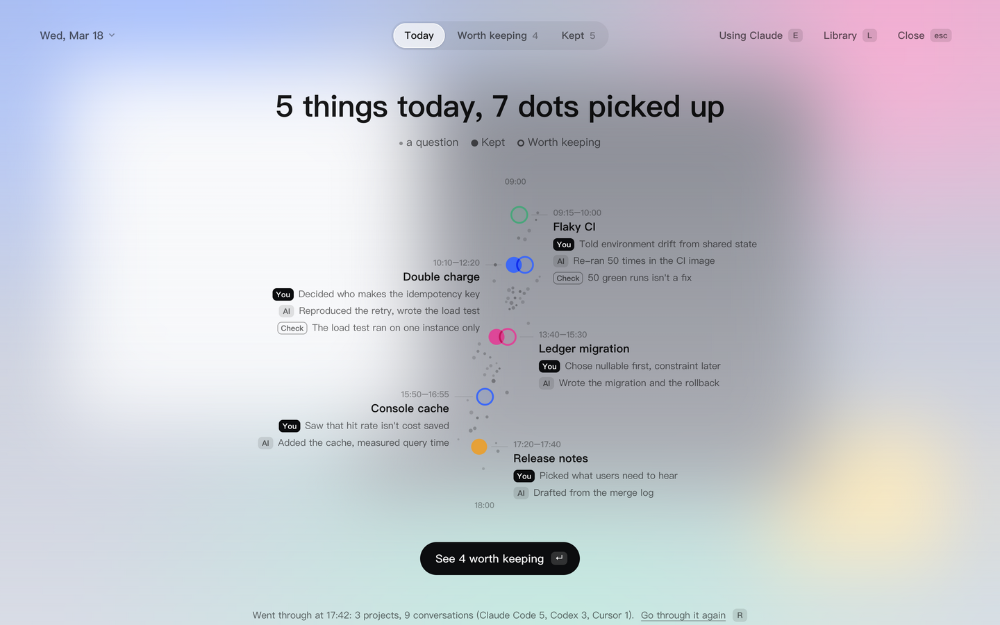
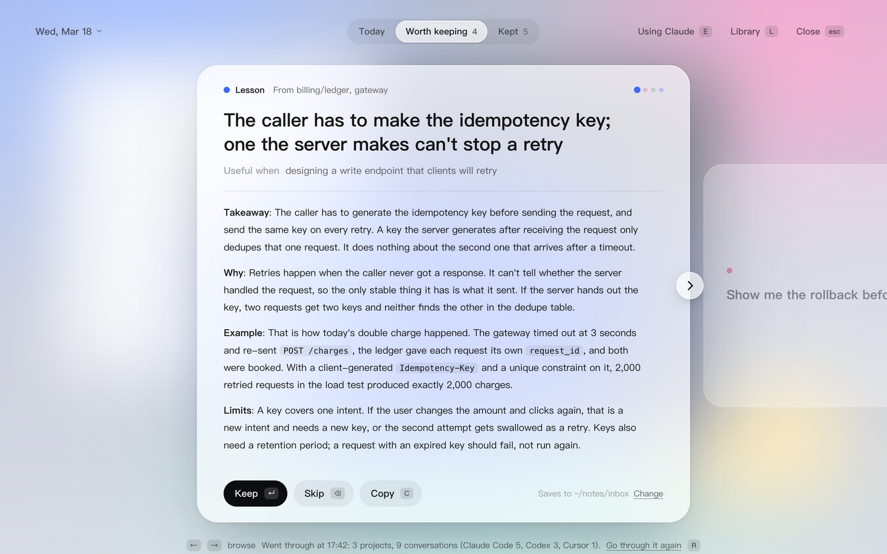
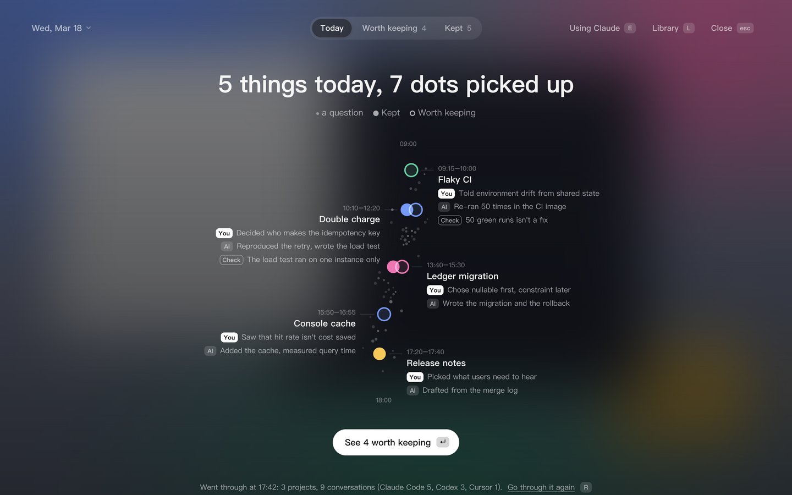
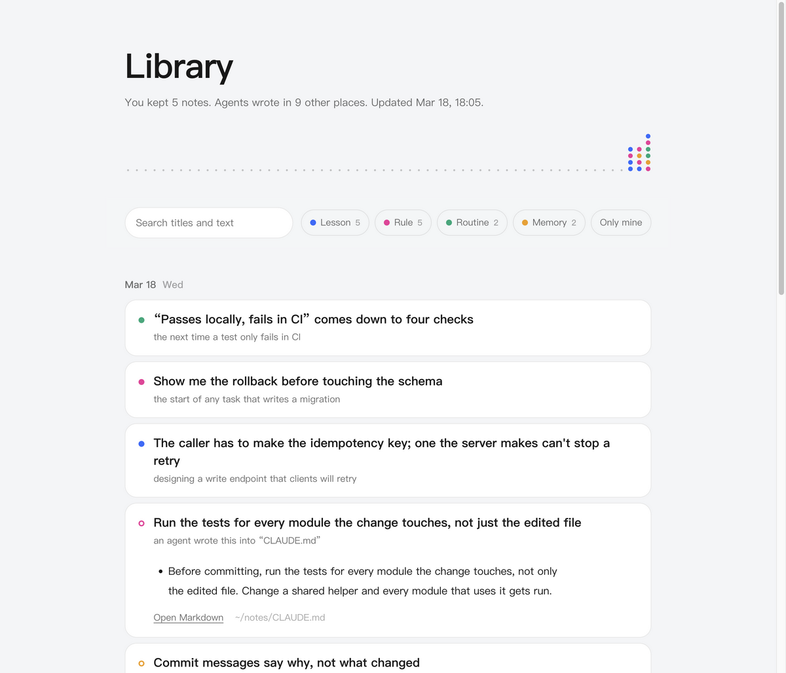

# dotjar

[中文](README.md) | English

After a day of working with AI agents, dotjar picks out **the ways of thinking worth keeping for the long run** and drops them, one at a time, into a jar. It runs in your browser, or as a sheet of frosted glass over your desktop.

It doesn't replay what each conversation did. It first lays the day out as a trickle of dots running down the page (what you worked on, when, what each thing turned up that is worth keeping, and which part was your own call), then hands you, one at a time, the things that would still help on another project three months from now, and asks whether to keep them.





It follows the system's light or dark appearance:



## Three views, one job each

- **Today**: what you see first. The day is a trickle of dots running down the page, morning at the top. Each question you asked is a small grey speck at the time you asked it: thick and wide where you were asking a lot, a few strays in the quiet hours. Each thing you worked on sits at the time you started on it, with the dots it turned up beside it. Each dot is one thing worth keeping, coloured by kind: solid once kept, a ring while it waits for you, a faint speck if you passed it over. Hover a dot for its title; click it to open it (the card if it is waiting, the Library page if it is kept). Beside each thing are its hours, the call you made, the call an agent made for you that you may not have noticed, and a Check line: a conclusion the agent gave without really verifying it, worth checking yourself. Before the day has been gone through there are no dots yet; each conversation is one thing under its own name (Claude Code and Codex both keep one), with its project and how many times you asked. Conversations without a name are grouped by project.
- **Worth keeping**: the candidates, one card at a time. What it keeps is not facts but ways of thinking: the aim is a map and judgment, knowing where to look when something happens and how to tell whether an answer is right (the idea comes from the takeaway skill). Facts you looked up, command flags and API details, things it is enough to know exist, are left out. Each card is one complete thought with a draft you can save as a note as is. Three kinds:
  - Lesson: a way of looking at a problem. The draft says when it should come to mind, where to look, why, where it came up today, how to tell if it's right, and when it doesn't apply
  - Rule: a trade-off to keep making, including where you corrected an agent and choices an agent made for you that are worth settling; it says what the alternatives were and why they lost
  - Routine: a way to check, telling whether a conclusion was really verified

  `Esc` goes back to Today.
- **Kept**: what has been kept today. Besides what you kept, it lists what agents wrote into your notes, rule files, memory and skills. That part is read straight from the records, with no model involved. Clicking an entry opens it in the Library, scrolled to and unfolded.

Click the date at the top left for a calendar. Days with records are shaded and say how many things were found, how many are still open, or that they haven't been gone through. Click a date to look at that day; tick the circle at a day's top right to go through several days in one go, oldest first, one model call per day.

A day can be gone through more than once. If you worked more after a morning pass, Today says how many new asks came since and offers to go through again (`R`). A second pass only adds what is new: candidates already listed stay as they are, and nothing kept or skipped comes back.

A candidate you haven't decided on doesn't vanish when the day ends. Anything left open from the past 90 days stays at the front of Worth keeping, marked with the day it came from. To look at yesterday's stream again, press `Y`. Open it in the morning before any work and yesterday is what you see.

## Running it

All it needs is Node (20 or newer). Nothing to install:

```bash
npm start
```

The server starts in the background, the page opens in your browser, and you can close the terminal. Open it the first time with the authorized address printed in the terminal; after that, bookmark `http://127.0.0.1:4747/`. Stop it with `npm run stop`. When dotjar's code is updated, the bottom of the page says the server behind it is still the old one; click “Restart it” to switch. Running `npm start` again switches too.

To never run that command again (macOS):

```bash
npm run service
```

Do this once and it starts at login from then on, so all you do is open the bookmark. Undo it with `npm run service:off`.

Why it isn't a plain page you can double-click: it has to read the agents' records on your machine and write notes into a folder. A page in a browser can do neither on its own, so a small server listening only on this machine (`127.0.0.1`) sits behind it.

To see what it looks like without reading anything from your machine:

```bash
npm run demo
```

| Key | What it does |
|---|---|
| `1` `2` `3` | Switch to Today, Worth keeping, Kept |
| `←` `→` | Browse the candidates. A sideways swipe on the trackpad, the arrows beside the card and the dots at its top right do the same; look through them all first, decide later |
| `↵` | Keep: write the draft to a Markdown note |
| `⌫` | Skip: it won't be offered again |
| `Z` | Undo the last step |
| `C` | Copy the draft |
| `R` | Go through the day again |
| `L` | Open the Library |
| `Esc` | From the cards or the list, back to Today |
| `Y` | Switch between today and yesterday. For earlier days, click the date at the top left and pick from the calendar |
| `E` | Switch who goes through the day: your local Claude, your local Codex, or your endpoint |
| `⌘V` | Add the clipboard's text to today's material |

### Or lay it over the desktop as frosted glass (optional)

The same interface can also sit over your desktop as a veil that drops on a shortcut and lifts when it loses focus. That needs Electron:

```bash
npm install
```

```bash
npm run veil
```

The veil adds two global shortcuts: `⌥⇧S` lowers and lifts it, and `⌥⇧C` adds the clipboard to today's material from any app. After it closes, the app keeps running; press `⌥⇧S`, click the Dock icon, click “Keep” in the menu bar, or run `npm run veil` again to bring it back, and quit with `⌘Q`. Run this way, the Dock shows the name Electron with dotjar's icon. The browser version and the veil can run at once and share the same data.

## Where kept things go

Every keep adds one plain Markdown file to the notes folder, `~/.dotjar/deposits/` by default. No Obsidian needed, and no note app at all. Click “Change” at the bottom right of a card to use any folder, such as your own notes directory or an Obsidian inbox.

### The Library: all your notes as one page



Press `L`, or click Library at the top right, to open `~/.dotjar/library.html` in your browser. It is a single self-contained page that loads nothing from the network, generated from the Markdown in the notes folder: ordered by day, searchable, filterable by kind, each note opening in place. What agents wrote into notes, rule files, memory and skills opens the same way, marked with a hollow dot: a file created that day opens in full, and a file added to shows only the sections added that day. An index page that only gained a link is left out. In the browser version each card can be removed once opened: a note you kept moves to `~/.dotjar/trash` and its candidate counts as skipped; something an agent wrote is only hidden, its file untouched; both can be undone straight away. It is regenerated on every keep, undo and open. The Markdown stays the only source of truth, so edit the notes directly.

To build it without the interface:

```bash
npm run library
```

## Where today's material comes from

1. **Conversation records from every agent on this machine.** Only what you said and each turn's closing message are read. Tool calls, tool output, timers, unattended runs started by other tools, and the recap an agent writes for itself when a conversation gets too long are not. The small line at the bottom of the interface says which agents were read today and how many conversations each.

   | Agent | Read from |
   |---|---|
   | Claude Code | `~/.claude/projects` |
   | Codex | `~/.codex/sessions` |
   | Cursor | `~/.cursor/projects/*/agent-transcripts` |
   | OpenClaw | `~/.openclaw/agents/*/sessions` |
   | Gemini CLI, Qwen Code | `~/.gemini/tmp/*/chats`, `~/.qwen/tmp/*/chats` |
   | opencode | `~/.local/share/opencode/storage` |
   | CodeBuddy, Claude Internal, tclaude | `~/.codebuddy/projects` and the like (same format as Claude Code) |

2. **Text you add yourself.** Copy something in any app and press `⌘V` back on the page (with the veil, `⌥⇧C` works from any app), or drop exported chats and meeting notes into `~/.dotjar/inbox/`. This is the way in for tools that keep no local records.

## Which model goes through the day

Three choices. Click at the top right (or press `E`) to switch between the ones available on your machine:

- **Your local Claude** (default): runs the `claude` command with no tools and no saved session.
- **Your local Codex**: runs `codex exec`, read-only, no web search, no saved session.
- **Any OpenAI-compatible endpoint**: a company gateway, DeepSeek, a local Ollama. Use this where neither command can be installed. Edit `~/.dotjar/config.json`:

```json
{
  "engine": "openai",
  "api": {
    "baseUrl": "https://your-gateway.example/v1",
    "model": "your-model-id",
    "apiKeyEnv": "YOUR_API_KEY_VARIABLE"
  }
}
```

The key can live in the environment variable named by `apiKeyEnv`, or directly in `api.apiKey`. The material is sent only to the one you pick.

## Other settings

All in `~/.dotjar/config.json`; restart to apply.

| Key | Meaning | Default |
|---|---|---|
| `language` | Interface language: `zh`, `en`, or `auto` to follow the system. Kept notes and the Library use the same one | `auto` |
| `wording` | Chinese only: what keeping is called across the interface (`落库`, `落袋`, `波点`, `归仓`, `攒`, `带走`, `存档`) | `落库` |
| `hotkey` | Lower or lift the veil | `Alt+Shift+S` |
| `captureHotkey` | Add the clipboard to today's material | `Alt+Shift+C` |
| `dayStartHour` | The hour a day starts; work after midnight counts toward the day before | `4` |
| `engine` | Who goes through the day: `claude-cli`, `codex-cli`, `openai`. Also switchable in the interface | `claude-cli` |
| `model` | Passed to `claude --model` | `sonnet` |
| `codexModel` / `codexEffort` | Model passed to Codex (empty uses its own default) and how hard it thinks | empty / `low` |
| `depositDir` | The notes folder | `~/.dotjar/deposits` |
| `noteDirs` | Folders besides Obsidian vaults whose `.md` files count as notes agents wrote | `[]` |

All interface text is in `src/overlay/words.js`.

## Command line

Everything also works without the interface, which is handy for checking what it saw and what it would send:

```bash
npm run scan
```

```bash
node bin/dotjar.js prompt
```

```bash
npm run distill
```

Command-line output is in Chinese for now.

## Where data lives

All under `~/.dotjar/` (change it with the `DOTJAR_HOME` environment variable):

- `days/2026-10-13.json`: one ledger per day, with the candidates, your decisions, and what agents wrote that day
- `deposits/`: the Markdown you kept
- `library.html`: the Library
- `trash/`: where a note goes when you undo a keep in the browser version (the veil uses the system Trash)
- `web-token`: authorization for the browser version
- `inbox/`: material you added yourself
- `config.json`

## Known limits

- Which thing a dot sits beside is marked by the model when it goes through the day. For days gone through before this was added, it is inferred from shared wording and can be wrong; dots it cannot place gather at the end of the stream. The hours are the model's estimate too, read from the times in the conversations; before the day is gone through, they are each conversation's first and last ask.
- Claude Code, Codex and OpenClaw were checked against real records. Cursor was checked against older records for format. Gemini CLI, Qwen Code, opencode and CodeBuddy had no data on the development machine and are covered only by tests written to their file formats.
- Cursor records carry no time per message, so a conversation that began before today contributes only its last few turns.
- What agents wrote is recognized from their file-writing records. A note changed through a shell command (`cat >>`, say) is not seen. Going through the day takes the agent's own “archived” remarks into account to avoid duplicates, but that note won't appear under Kept.
- Notes written by agents are recognized only inside Obsidian vaults (a folder containing `.obsidian`) and the folders listed in `noteDirs`. If you don't use Obsidian, add your notes folder to `noteDirs`. Rule files, memory and skills are recognized regardless.
- When a day's material passes roughly 90,000 characters, long conversations keep only their first and last few turns.
- The prompt sent to the model is written in Chinese. It tells the model to answer in English when the interface is English.
- The frosted glass is macOS's own material. Windows uses acrylic, and Linux gets only the translucent tint. So far it has only been run on macOS.

## Development

```bash
npm test
```

```bash
npm run shot
```

`npm run shot` renders a screenshot of the demo day to `shots/veil.png` without ever showing a window. Add `-- --lang=en`, `-- --theme=dark` or `-- --view=open` for other states. The code:

- `src/core/sources.js` reads the day's records (Claude Code, Codex, text you added)
- `src/core/agents.js` reads the other local agents
- `src/core/durable.js` decides whether a file is something kept for the long run, and what kind
- `src/core/day.js` gathers what agents wrote and condenses the material for the model
- `src/core/distill.js` the prompt and the two engines
- `src/core/ledger.js` the daily ledger and saving notes
- `src/core/library.js` the Library page
- `src/core/session.js` everything the interface can ask for, whoever is hosting it
- `src/overlay/` the interface (plain HTML, CSS and JS; open `overlay.html` in a browser to see the demo)
- `src/main.js` the desktop shell: the veil window, Dock, menu bar and shortcuts, connecting the interface to a session over IPC
- `src/server.js` the local web server, connecting the same interface to a session over HTTP

There is one interface and two ways to host it. The desktop shell lays it over the screen as system-level frosted glass. The web server puts it in a browser. The server listens only on `127.0.0.1`, and every request must carry the authorization in `~/.dotjar/web-token` (traded for a browser cookie on first open), so neither another website nor another user on the same machine can call it.
