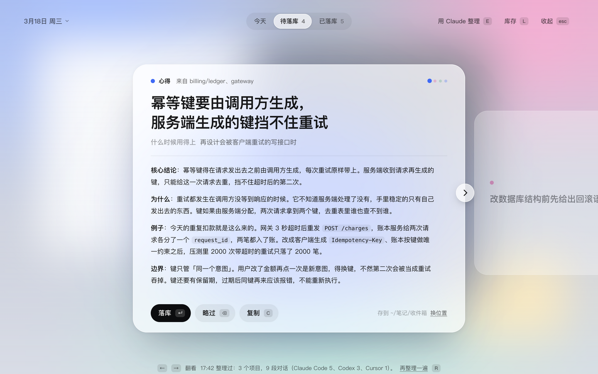
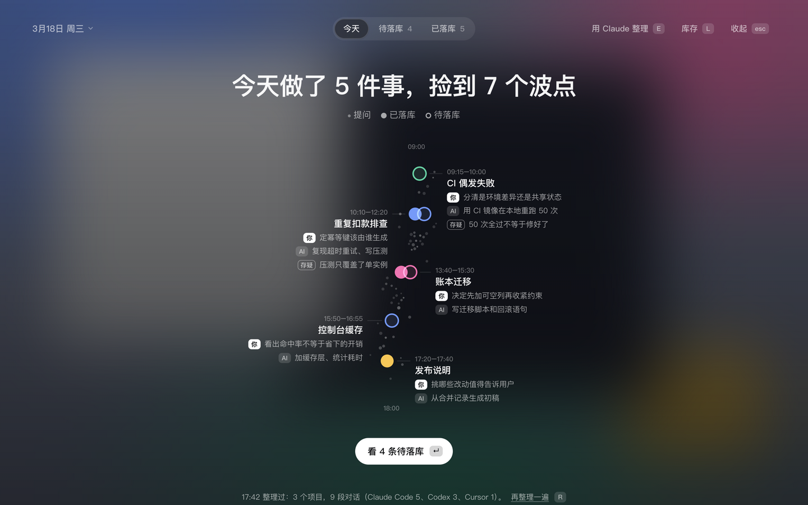
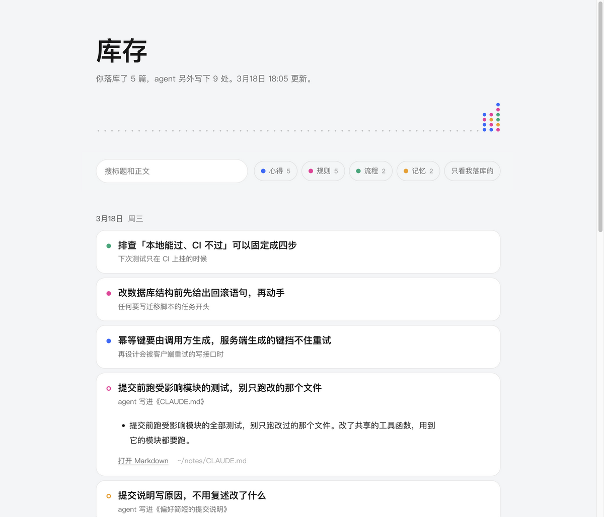

# dotjar

中文 | [English](README.en.md)

和 AI agent 一起干完一天的活，dotjar 帮你把其中**值得长期留下的思考方式**挑出来，一颗一颗放进罐子里。在浏览器里打开就能用，也可以像一层毛玻璃那样盖在桌面上；喜欢桌宠的话，[clawd-insights](https://github.com/yx0716/clawd-insights) 里的小螃蟹会陪着你一起捡波点。

它不回放每段对话做了什么。它先把今天画成一条由点组成的细流：从早到晚做了哪几件事、每件事捡到了哪些值得留下的波点、哪部分是你自己的判断，再把换个项目、过三个月还用得上的东西一条一条拿给你，问你留不留。




界面跟随系统的明暗：



## 三个画面，各做一件事

- **今天**：打开先看到的一屏。今天画成一股从上往下流的细流，上游是早上，越往下越晚；你的每一次提问是一个小灰点，落在提问的那个时刻，问得多的时段灰点就密、散得宽，闲下来时只剩零星几个。做过的每件事落在开始做它的那个时刻，旁边挂着从这件事里捡到的波点：一个波点是一条值得留下的东西，颜色是它的种类，实心的已落库，空心的还等你挑，略过的变成很淡的小点。鼠标停在波点上能看到标题，点一下打开它（待落库的翻到那张卡片，已落库的在库存里打开）。每件事旁边标着起止时间，写明哪个判断是你自己做的、哪个是 AI 替你做的（你可能没注意到），以及「存疑」：AI 给出但没真正验证过、值得你自己去验的结论。还没整理时还没有波点，一段对话是一件事，用对话自己的标题（Claude Code 和 Codex 的记录里都有），旁边标着项目和提问次数；没有标题的对话按项目归在一起。
- **待落库**：整理出的候选，一次一张卡片。留下的不是知识点，是思考方式：目标是形成地图和判断力，知道遇到什么现象该往哪想、能看出一个答案对不对（思路来自 takeaway 这个 skill）。查到的事实、命令参数、API 细节这类“知道有这回事就行”的不收。每张是一句完整的想法，附一份可以直接存成笔记的草稿。分三类：
  - 心得：一种看问题的方式。草稿写什么时候该想到它、往哪想、为什么、今天在哪用上的、怎么看出对不对、什么时候不适用
  - 规则：一个以后照着做的取舍，包括你纠正过 agent 的地方，和 agent 替你做了、值得定下来的选择；写出当时还有什么别的做法、为什么没选
  - 流程：一套验证办法，怎么看出一个结论是不是真的验证过

  按 `Esc` 回到「今天」。
- **已落库**：今天已经留下的。除了你自己落库的，还包括 agent 今天写进知识库、规则文件、记忆和 skill 的内容，这部分直接从记录里读，不经过模型。点一条会在库存页里打开并定位到它。

左上角的日期点开是一张日历：有记录的日子底色深一些，写着整理出几件事、还有几条待定、或者还没整理。点日期去看那一天；在日子右上角打勾，可以一次打捞好几天，按日期从早到晚逐天整理，每天一次模型调用。

同一天可以整理好几次：上午整理过、下午又干了活，第一屏会提示「之后又问了 N 次，再整理一遍」，按 `R` 就行。再整理只会补上新挑出来的，已经挑出、还没定的不会被换掉，已经落库或略过的也不会再出现。

没定的候选不会因为过了一天就消失：前几天（最多 90 天）还没处理的，会一直排在「待落库」最前面，卡片上标着是哪天留下的。想回看昨天那条溪，按 `Y`；早上还没开始干活时，打开看到的就是昨天。

## 运行

只要有 Node（20 或更新），不用装任何依赖：

```bash
npm start
```

服务会在后台跑起来，页面在浏览器里打开，终端可以直接关掉。第一次用终端里打印的带授权的地址打开，之后收藏 `http://127.0.0.1:4747/` 就行。停掉用 `npm run stop`。dotjar 的代码更新以后，页面底部会提示后台服务还是旧的，点「重启服务」就换成新的；再跑一次 `npm start` 也会自动换。

想连这条命令都不用再跑（macOS）：

```bash
npm run service
```

装一次，以后登录就自动启动，只用开收藏夹。取消是 `npm run service:off`。

它为什么不是一个双击就能开的纯网页：它要读本机各个 agent 的记录，还要把笔记写进文件夹，浏览器里的页面自己做不到这两件事，所以后面得有一个只监听本机（`127.0.0.1`）的小服务。

想先看看样子、不读任何本机数据：

```bash
npm run demo
```

| 按键 | 作用 |
|---|---|
| `1` `2` `3` | 切到「今天」「待落库」「已落库」 |
| `←` `→` | 翻看候选。也可以在触控板上左右滑、点卡片两侧的箭头或右上角的小圆点；先看一遍再决定，不用一条条处理完 |
| `↵` | 落库：把草稿写成一篇 Markdown |
| `⌫` | 略过：以后的整理不再提它 |
| `Z` | 撤销上一步 |
| `C` | 复制草稿 |
| `R` | 重新整理 |
| `L` | 打开库存 |
| `Esc` | 从卡片或列表回到「今天」 |
| `Y` | 在今天和昨天之间切换。更早的日子点左上角的日期，用日历选 |
| `E` | 换一个来整理：本机的 Claude、本机的 Codex、或你配置的接口 |
| `⌘V` | 把剪贴板里的文字存进今天的材料 |

### 也可以铺成桌面上的一层毛玻璃（可选）

同一套界面还能作为蒙版盖在桌面上，按快捷键落下、失焦收起。这需要 Electron：

```bash
npm install
```

```bash
npm run veil
```

蒙版多两个全局快捷键：`⌥⇧S` 落下 / 收起，`⌥⇧C` 在任何应用里把剪贴板存进今天的材料。收起之后应用还在运行，按 `⌥⇧S`、点 Dock 里的图标、点菜单栏的「落库」、或再跑一次 `npm run veil` 都能叫回来；退出用 `⌘Q`。用这种方式运行时，Dock 里的名字会显示成 Electron，图标是 dotjar 的。网页和蒙版可以同时开着，用的是同一份数据。

## 留下的东西存在哪

每落库一条，就在笔记文件夹里多一篇普通的 Markdown，默认是 `~/.dotjar/deposits/`。不需要 Obsidian，也不依赖任何笔记软件；在卡片右下角点「换位置」可以改成任意文件夹，比如你自己的笔记目录或 Obsidian 库的收件箱。

### 库存：所有笔记合成的一个网页



按 `L`，或点右上角的「库存」，会在浏览器里打开 `~/.dotjar/library.html`。它是一个不联网的单文件网页，由笔记文件夹里的 Markdown 生成：按天排列，可以搜索、按类别筛选、点开看全文。agent 自己写进笔记、规则文件、记忆和 skill 的内容也一样是卡片，圆点是空心的：当天新建的文件点开是全文，往已有文件里补的只显示当天补进去的那几节；只往索引页加了一行链接的不算。在网页版里，每张卡片展开后可以「移出库存」：你落库的笔记挪进 `~/.dotjar/trash`，候选记为略过；agent 写的只是不再显示，原文件不动；都能马上撤销。每次落库、撤销和打开时都会重新生成，Markdown 始终是唯一的数据源，直接改笔记就行。

不开界面也能生成：

```bash
npm run library
```

## 今天的材料从哪来

1. **本机所有 agent 的对话记录**。只取你说的话和 agent 每轮的收尾消息；工具调用、工具输出、定时任务、其他工具发起的无人值守会话，以及对话太长时 agent 自动写的前情摘要，都不读。界面底部那行小字会写明今天读到了哪些 agent、各几段。

   | agent | 读取位置 |
   |---|---|
   | Claude Code | `~/.claude/projects` |
   | Codex | `~/.codex/sessions` |
   | Cursor | `~/.cursor/projects/*/agent-transcripts` |
   | OpenClaw | `~/.openclaw/agents/*/sessions` |
   | Gemini CLI、Qwen Code | `~/.gemini/tmp/*/chats`、`~/.qwen/tmp/*/chats` |
   | opencode | `~/.local/share/opencode/storage` |
   | CodeBuddy、Claude Internal、tclaude | `~/.codebuddy/projects` 等（与 Claude Code 同一种格式） |

2. **你手动存入的文字**。在豆包、网页、任何应用里复制一段，回到页面按 `⌘V`（用蒙版时在任何应用里按 `⌥⇧C` 即可），或者把导出的对话、会议纪要放进 `~/.dotjar/inbox/`。没有本地记录的工具走这条路。

## 用哪个模型整理

三种可选，右上角点一下（或按 `E`）就能在这台机器上可用的几个之间切换：

- **本机的 Claude**（默认）：调用 `claude` 命令，不给工具、不留会话记录。
- **本机的 Codex**：调用 `codex exec`，只读、不联网搜索、不留会话记录。
- **任意 OpenAI 兼容的接口**：公司的模型网关、豆包（火山方舟）、DeepSeek、本地的 Ollama。两个命令都装不了的环境用这个，编辑 `~/.dotjar/config.json`：

```json
{
  "engine": "openai",
  "api": {
    "baseUrl": "https://ark.cn-beijing.volces.com/api/v3",
    "model": "你的模型或接入点 ID",
    "apiKeyEnv": "ARK_API_KEY"
  }
}
```

密钥可以放在 `apiKeyEnv` 指向的环境变量里，也可以直接写在 `api.apiKey`。材料只发往你选的这一个。

## 其他配置

都在 `~/.dotjar/config.json`，改完重启生效：

| 键 | 含义 | 默认 |
|---|---|---|
| `language` | 界面语言：`zh`、`en`，或 `auto` 跟随系统。落库的笔记和库存页用同一种语言 | `auto` |
| `wording` | 「留下」这件事叫什么。整套界面用词跟着换：`落库`（待落库 / 库存）、`落袋`（待落袋 / 口袋）、`波点`（待收集 / 波点集）、`归仓`（待归仓 / 谷仓）、`攒`（值得攒 / 家底）、`带走`（能带走 / 背包）、`存档`（待存档 / 档案） | `落库` |
| `hotkey` | 落下 / 收起蒙版 | `Alt+Shift+S` |
| `captureHotkey` | 把剪贴板存进今天的材料 | `Alt+Shift+C` |
| `dayStartHour` | 一天从几点算起，凌晨的工作算前一天 | `4` |
| `engine` | 谁来整理：`claude-cli`、`codex-cli`、`openai`。界面里也能切 | `claude-cli` |
| `model` | 传给 `claude --model` | `sonnet` |
| `codexModel` / `codexEffort` | 传给 Codex 的模型（留空用它自己的默认）和思考强度 | 空 / `low` |
| `depositDir` | 笔记文件夹 | `~/.dotjar/deposits` |
| `noteDirs` | 除 Obsidian 库之外，还有哪些文件夹里的 `.md` 算 agent 写下的笔记 | `[]` |

界面上所有的字都在 `src/overlay/words.js` 里，中英各一份；想加一套自己的说法，照着加一组即可。

## 命令行

不开界面也能用，方便检查它看到了什么、会发出去什么：

```bash
npm run scan
```

```bash
node bin/dotjar.js prompt
```

```bash
npm run distill
```

## 数据放在哪

全部在 `~/.dotjar/`（可用环境变量 `DOTJAR_HOME` 改）：

- `days/2026-10-13.json`：每天一个台账，记着候选、你的决定、agent 当天写下了什么
- `deposits/`：你留下的 Markdown
- `library.html`：库存
- `trash/`：网页版里撤销落库时，笔记挪到这里（蒙版里是移进系统废纸篓）
- `web-token`：网页版的授权
- `inbox/`：手动存入的材料
- `config.json`

## 已知的边界

- 每个波点挂在哪件事旁边，是模型整理时标的。这个功能加上之前整理过的日子，按文字相近程度推断，可能挂错；推断不出来的放在溪流末尾。起止时间也是模型照着对话时间估的；还没整理时，用的是每段对话第一次和最后一次提问的时间。
- Claude Code、Codex、OpenClaw 用今天的真实记录验证过，Cursor 用本机的旧记录核对过格式；Gemini CLI、Qwen Code、opencode、CodeBuddy 这台机器上没有数据，只按它们的文件格式写了测试。
- Cursor 的记录里每条消息没有时间，今天之前开始的会话只取最后几轮。
- agent 写下的东西靠它的写文件记录识别。用 shell 命令改的笔记（比如 `cat >>`）读不到；整理时会参考 agent 说过的「已归档」来避免重复，但「已落库」里不会出现这篇笔记。
- agent 写的笔记只认 Obsidian 库（目录里有 `.obsidian`）和 `noteDirs` 里配置的文件夹。不用 Obsidian 的话，把自己的笔记目录填进 `noteDirs`。规则文件、记忆和 skill 的识别与此无关。
- 一天的材料超过约 9 万字时，长会话只保留开头和结尾的几轮。
- 毛玻璃用的是 macOS 的系统材质；Windows 用 acrylic，Linux 上只有半透明的色层。目前只在 macOS 上跑过。

## 开发

```bash
npm test
```

```bash
npm run shot
```

`npm run shot` 用演示数据渲染一张截图到 `shots/veil.png`，全程不显示窗口；加 `-- --lang=en`、`-- --theme=dark`、`-- --view=open`、`-- --words=攒` 可以看其他状态。代码结构：

- `src/core/sources.js` 读当天的记录（Claude Code、Codex、手动存入）
- `src/core/agents.js` 其他本地 agent 的读取
- `src/core/durable.js` 判断一个文件算不算长期留下的东西、算哪一类
- `src/core/day.js` 汇总 agent 写下的文件，压缩出交给模型的材料
- `src/core/distill.js` 提示词和两种引擎
- `src/core/ledger.js` 台账与存档
- `src/core/library.js` 库存网页
- `src/core/session.js` 界面能发起的全部操作，与由谁承载无关
- `src/overlay/` 界面（纯 HTML / CSS / JS，可以直接在浏览器里打开 `overlay.html` 看演示）
- `src/main.js` 桌面外壳：蒙版窗口、Dock、菜单栏、快捷键，通过 IPC 把界面接到 session
- `src/server.js` 本机网页服务，通过 HTTP 把同一个界面接到 session

界面只有一份，承载它的方式有两种：桌面外壳把它铺成一层系统级的毛玻璃，网页服务把它放进浏览器。网页服务只监听 `127.0.0.1`，每个请求都要带 `~/.dotjar/web-token` 里的授权（首次打开时换成浏览器 cookie），别的网站和同一台机器上的其他用户都调不到它。
