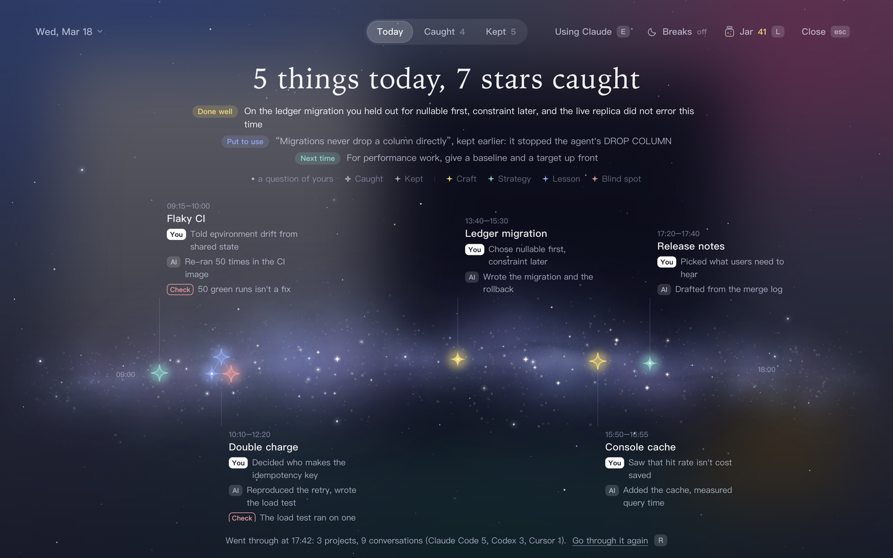
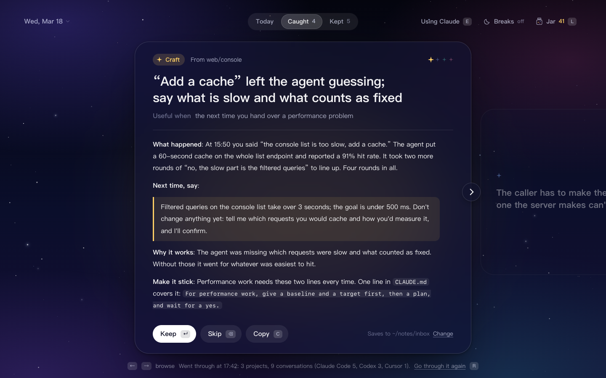
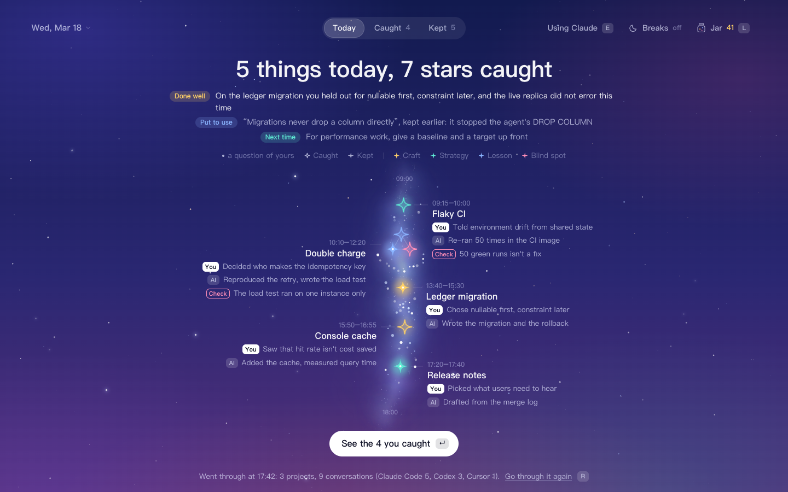
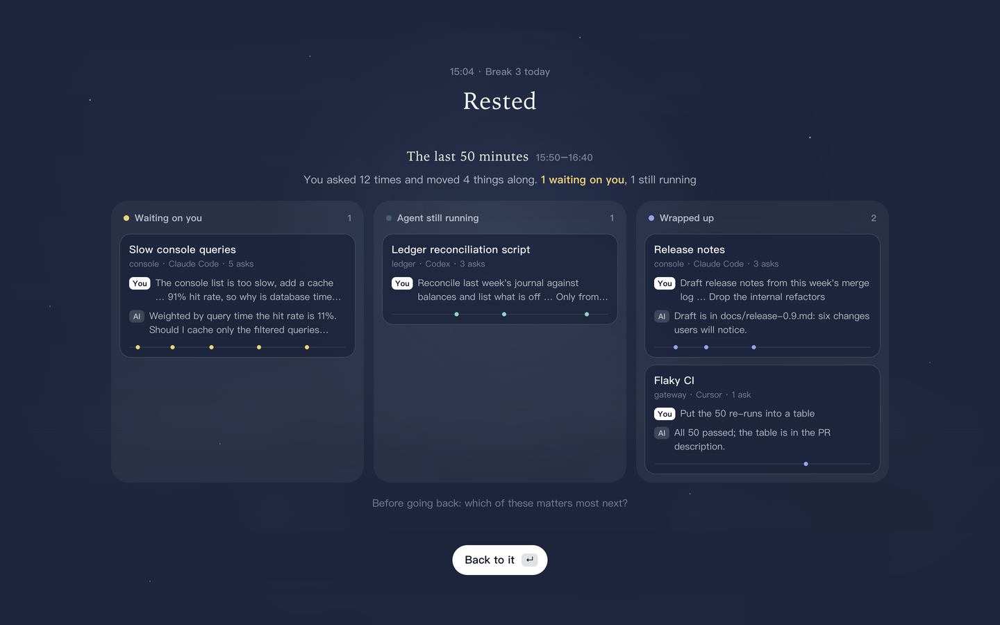
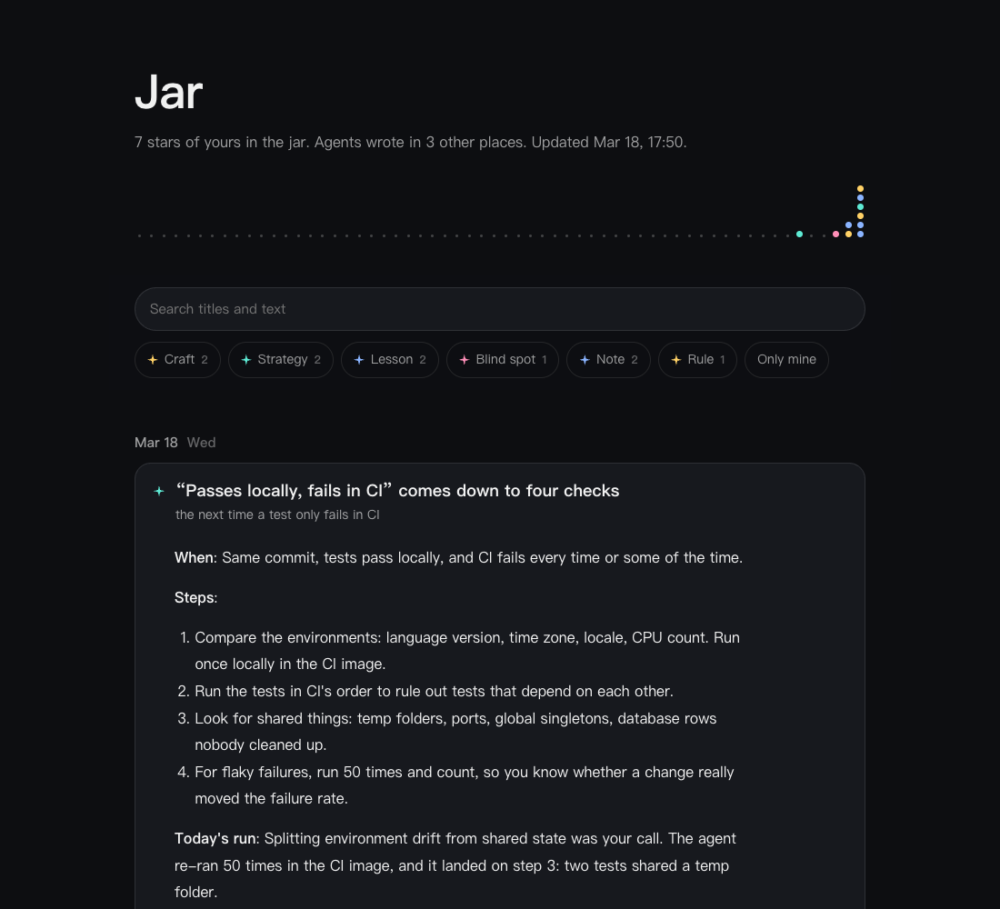

# dotjar guide

[中文](guide.md) | English · [Back to the README](../README.en.md)

After a day of working with AI agents, dotjar lays the day out as a river of stars: it shows where you could have worked with the agent more smoothly, and brings up **the strategies, lessons and blind spots worth keeping for the long run**, one star at a time, into a jar. It runs in your browser, or as a sheet of frosted glass over your desktop; if you like desktop pets, the crab in [clawd-insights](https://github.com/yx0716/clawd-insights) fishes with you.

It doesn't replay what each conversation did. It first draws the day as a river running from morning to night (what you worked on, which stars each thing yielded, and which part was your own call), then hands you, one card at a time, the things that would still help on another project three months from now, and asks whether to keep them.





In Chinese, the interface's own titles are set in 汇文明朝体 (Huiwen-mincho) and what the day's work turned up in 霞鹜文楷 (LXGW WenKai); both travel with the project as cut-down fonts, so nothing has to be installed and nothing is loaded from the network. In English the system's faces are used.

It follows the system's appearance. Dark is midnight. Light is a slate-blue ground with large soft fields of colour on it: aqua, denim blue, rose and a little cream.



## Three views, one job each

- **Today**: what you see first. In wide windows, the day is a galaxy spanning the window, from morning on the left to evening on the right; in narrow windows it runs down the page, morning at the top. Each question you asked is one small star in it, at the time you asked: the river is wide and bright where you were asking a lot, narrower and fainter in the quiet hours. Dust drifts along in the direction of time; the stars that stand for questions stay put (with “reduce motion” on in the system, the whole river holds still). Each thing you worked on sits at the time you started on it, with the stars it yielded beside it. Each star is one thing worth keeping, coloured by kind: solid and glowing once kept, an outline while it waits for you, a faint small one if you passed it over. The stars of one thing are joined into a small constellation. Hover a star for its kind and title; click it to open it (the card if it is waiting, its page in the Jar if it is kept). Beside each thing are its hours, the call you made, the call an agent made for you that you may not have noticed, and a Check line: a conclusion the agent gave without really verifying it, worth checking yourself.

  Under the title are three kinds of feedback on the day itself. **Done well** is one specific thing you did, a fact and not a compliment, left out when there is none. **Put to use** means the model found a match between today's actions and an earlier keeper; click the text to open that note. **Next time** is one small thing to try, aimed at wherever today cost you the most rounds. Check a row to mark it as read: it dissolves into a small burst of starlight and tucks away. This acknowledges reading, not agreement with the model. Expand the tucked-away rows to read them again or uncheck them. Read state stays in this browser by date and content across reloads; new feedback still appears. With reduced motion enabled, rows tuck away without animation. The jar at the top right says how many stars it holds by now.

  Before the day has been gone through the river holds only your questions, under a line from the *Book of Songs* (the sky has its river of stars; look into it, and it too gives light); each conversation is one thing under its own name (Claude Code and Codex both keep one), with its project and how many times you asked. Conversations without a name are grouped by project.
- **Caught**: the candidates, one card at a time. Each is one complete thought with a draft you can save as a note as is, and each points at a moment of today; advice that would fit any day (“be specific”) is left out, and so are facts you looked up, command flags and API details. Four kinds:
  - **Craft**: how to work with the agent. The draft quotes what you said and the back-and-forth it caused, gives wording you can copy and use next time, and says what the agent was missing; if it is something you would have to say every time, it also gives a line or two for `CLAUDE.md` / `AGENTS.md`. Things you did well are caught too, as something to keep doing. Two a day at most.
  - **Strategy**: a way of going at a kind of problem. When to use it, the steps (and what to look at in each), how today's run went, when it fails. Ways of checking belong here.
  - **Lesson**: a judgement the work earned. What happened, what is going on underneath (drawn as an arrow chain or a small table where it can be), what to check first next time, where it stops holding.
  - **Blind spot**: a case that is easy to leave out. What was missed, why it is easy to miss, the one question to ask before starting next time. Ones you actually ran into are caught; one that nobody raised but the material says should have been considered may be caught too, marked as not verified yet.

  `Esc` goes back to Today.
- **Kept**: what has been kept today. Besides what you kept (stars), it lists what agents wrote into your notes, rule files, memory and skills (small rings). That part is read straight from the records, with no model involved. Clicking an entry opens it in the Jar, scrolled to and unfolded.

Click the date at the top left for a calendar. Days with records are shaded and say how many things were found, how many are still open, or that they haven't been gone through. Click a date to look at that day; tick the circle at a day's top right to go through several days in one go, oldest first, one model call per day.

A day can be gone through more than once. If you worked more after a morning pass, Today says how many new asks came since and offers to go through again (`R`). A second pass only adds what is new: candidates already listed stay as they are, and nothing kept or skipped comes back.

A candidate you haven't decided on doesn't vanish when the day ends. Anything left open from the past 90 days stays at the front of Caught, marked with the day it came from. To look at yesterday's river again, press `Y`. Open it before any work today and what you see is the last day that had some (Friday, on a Monday morning), looking back a week at most.

## Breaks

The moon at the top right opens timed breaks: every 25 / 50 / 90 minutes, for 3 / 5 / 10 minutes. Off by default.



- The time counts from when you start asking an agent. A stretch with no questions to an agent is not a stretch of work and brings no reminder. Time away from the keyboard that is as long as a break counts as one, and the count starts over when you are back (macOS). If you happen to be away when one falls due, it waits for you.
- On macOS, a native full-screen reminder covers each display, even with the browser closed or behind other apps. It uses the same sky, fonts and countdown, without installing Electron. If the native window fails to load, it falls back to the browser. Other systems still use the page or browser notifications. With the frosted-glass veil, the veil lowers itself.
- In the last minute of the break, a look back at the stretch before it comes up, in three columns: **Waiting on you** (the agent ended on a question, or stopped mid-turn a long while ago), **Agent still running**, **Wrapped up**. Each card is one conversation: what you set going in this stretch, the latest thing you said, how the agent left it, and a thin line marking when each of your questions fell. The look back refreshes when the countdown ends and stays until you press `↵` or “Back to it”. Loading is visible; failed reads retry every five seconds, with a manual retry too. An unattended break closes 30 minutes after its countdown ends.
- You can skip (`Esc`; it does not count toward today's breaks, and the timing starts over) or ask for five more minutes. “Take one now” starts a break by hand at any time, with or without the timer.
- The look back is read straight from the conversation records on this machine. No model is called, it costs nothing, and nothing is sent anywhere.

## Running it

All it needs is Node (20 or newer). Nothing to install:

```bash
npx github:yx0716/dotjar
```

The server starts in the background, the page opens in your browser, and you can close the terminal. Open it the first time with the authorized address printed in the terminal; after that, bookmark `http://127.0.0.1:4747/`. To stop it:

```bash
npx github:yx0716/dotjar stop
```

To have a plain `dotjar` command from then on, install it globally:

```bash
npm install -g github:yx0716/dotjar
```

To never run a command again (macOS), install it globally as above, then:

```bash
dotjar service install
```

Do this once and it starts at login from then on, so all you do is open the bookmark. Undo it with `dotjar service uninstall`. (It can be set up through `npx` too, but then it points into npx's cache and stops working when the cache is cleared.)

To remove it, run `dotjar uninstall`. It lists the program files, command entry and login item it would remove and asks before doing anything; your records and notes stay. Add `--purge` to move the data folder to the Trash as well. Details are in [installation and updates](updates.md#卸载) (Chinese).

For source development, use `npm run dev`. It runs in the foreground with separate data and an automatically assigned port; press Ctrl+C to stop it. Demo data is the default. See [development and installation checks](development.md) (Chinese) for enabling real records, model calls or installer verification. Development instances do not register login services.

Why it isn't a plain page you can double-click: it has to read the agents' records on your machine and write notes into a folder. A page in a browser can do neither on its own, so a small server listening only on this machine (`127.0.0.1`) sits behind it.

To see what it looks like without reading anything from your machine:

```bash
npx github:yx0716/dotjar demo
```

On a day with no conversations yet, the page offers the same made-up day.

| Key | What it does |
|---|---|
| `1` `2` `3` | Switch to Today, Caught, Kept |
| `←` `→` | Browse the candidates. A sideways swipe on the trackpad, the arrows beside the card and the small stars at its top right do the same; look through them all first, decide later |
| `↵` | Keep: write the draft to a Markdown note; the star flies into the jar |
| `⌫` | Skip: it won't be offered again |
| `Z` | Undo the last step |
| `C` | Copy the draft |
| `R` | Go through the day again |
| `L` | Open the Jar |
| `Esc` | From the cards or the list, back to Today; during a break, skip it |
| `Y` | Switch between today and yesterday. For earlier days, click the date at the top left and pick from the calendar |
| `E` | Switch who goes through the day: your local Claude, your local Codex, or your endpoint |
| `⌘V` | Add the clipboard's text to today's material |

### Or lay it over the desktop as frosted glass (optional)

The same interface can also sit over your desktop as a veil that drops on a shortcut and lifts when it loses focus. That needs a clone of the repository and Electron:

```bash
npm install
```

```bash
npm run veil
```

The veil adds two global shortcuts: `⌥⇧S` lowers and lifts it, and `⌥⇧C` adds the clipboard to today's material from any app. After it closes, the app keeps running; press `⌥⇧S`, click the Dock icon, click its icon in the menu bar, or run `npm run veil` again to bring it back, and quit with `⌘Q`. Run this way, the Dock shows the name Electron with dotjar's icon. The browser version and the veil can run at once and share the same data.

## Where kept things go

Every keep adds one plain Markdown file to the notes folder, `~/.dotjar/deposits/` by default. No Obsidian needed, and no note app at all. Click “Change” at the bottom right of a card to use any folder, such as your own notes directory or an Obsidian inbox.

### The Jar: all your notes as one page



Press `L`, or click the jar at the top right, to open `~/.dotjar/library.html` in your browser. It is a single self-contained page that loads nothing from the network, generated from the Markdown in the notes folder: ordered by day, searchable, filterable by kind, each note opening in place. What you kept is marked with a star. What agents wrote into notes, rule files, memory and skills opens the same way, marked with a small ring: a file created that day opens in full, and a file added to shows only the sections added that day. An index page that only gained a link is left out. In the browser version each card can be removed once opened: a note you kept moves to `~/.dotjar/trash` and its candidate counts as skipped; something an agent wrote is only hidden, its file untouched; both can be undone straight away. It is regenerated on every keep, undo and open. The Markdown stays the only source of truth, so edit the notes directly.

To build it without the interface:

```bash
dotjar library
```

## Where today's material comes from

1. **Conversation records from every agent on this machine.** Only what you said and each turn's closing message are read. Tool calls, tool output, timers, unattended runs started by other tools, and the recap an agent writes for itself when a conversation gets too long are not. The small line at the bottom of the interface says which agents were read today and how many conversations each.

   | Agent | Read from |
   |---|---|
   | Claude Code | `~/.claude/projects` |
   | Codex | `~/.codex/sessions` |
   | Cursor | `~/.cursor/projects/*/agent-transcripts` |
   | OpenClaw | `~/.openclaw/agents/*/sessions` |
   | Gemini CLI, Qwen Code | `~/.gemini/tmp/*/chats`, `~/.qwen/tmp/*/chats` |
   | opencode | `~/.local/share/opencode/storage` |
   | CodeBuddy, Claude Internal, tclaude | `~/.codebuddy/projects` and the like (same format as Claude Code) |

2. **Text you add yourself.** Copy something in any app and press `⌘V` back on the page (with the veil, `⌥⇧C` works from any app), or drop exported chats and meeting notes into `~/.dotjar/inbox/`. This is the way in for tools that keep no local records.

## Which model goes through the day

Three choices, and nothing to set up: `claude` is used if it is installed, `codex` if not, and an endpoint if you have configured one and neither is there. When more than one is available, click at the top right (or press `E`) to switch; your choice is remembered:

- **Your local Claude**: runs the `claude` command with no tools and no saved session.
- **Your local Codex**: runs `codex exec`, read-only, no web search, no saved session.
- **Any OpenAI-compatible endpoint**: a company gateway, DeepSeek, a local Ollama. Use this where neither command can be installed. Edit `~/.dotjar/config.json`:

```json
{
  "engine": "openai",
  "api": {
    "baseUrl": "https://your-gateway.example/v1",
    "model": "your-model-id",
    "apiKeyEnv": "YOUR_API_KEY_VARIABLE"
  }
}
```

The key can live in the environment variable named by `apiKeyEnv`, or directly in `api.apiKey`. The material is sent only to the one you pick. Going through a day is one model call.

## Other settings

All in `~/.dotjar/config.json`; restart to apply.

| Key | Meaning | Default |
|---|---|---|
| `language` | Interface language: `zh`, `en`, or `auto` to follow the system. Kept notes and the Jar use the same one | `auto` |
| `wording` | Chinese only: what keeping is called across the interface (`打捞`, `落库`, `落袋`, `归仓`, `攒`, `带走`, `存档`) | `打捞` |
| `rest` | Timed breaks: `{ "enabled": false, "everyMin": 50, "forMin": 5 }`. Also set from the interface; here it takes lengths the interface does not offer | off |
| `hotkey` | Lower or lift the veil | `Alt+Shift+S` |
| `captureHotkey` | Add the clipboard to today's material | `Alt+Shift+C` |
| `dayStartHour` | The hour a day starts; work after midnight counts toward the day before | `4` |
| `engine` | Who goes through the day: `auto` (whichever is installed), `claude-cli`, `codex-cli`, `openai`. Also switchable in the interface | `auto` |
| `model` | Passed to `claude --model` | `sonnet` |
| `codexModel` / `codexEffort` | Model passed to Codex (empty uses its own default) and how hard it thinks | empty / `low` |
| `depositDir` | The notes folder | `~/.dotjar/deposits` |
| `noteDirs` | Folders besides Obsidian vaults whose `.md` files count as notes agents wrote | `[]` |

All interface text is in `src/overlay/words.js`.

## Command line

The installed version also works without the interface, which is handy for checking what it saw and what it would send. Source debugging requires an explicit isolated environment; see [development and installation checks](development.md):

```bash
dotjar scan
```

```bash
dotjar prompt
```

```bash
dotjar distill
```

Command-line output is in Chinese for now.

## Where data lives

All under `~/.dotjar/` (change it with the `DOTJAR_HOME` environment variable):

- `days/2026-10-13.json`: one ledger per day, with the candidates, your decisions, the day's feedback, and what agents wrote that day
- `deposits/`: the Markdown you kept
- `library.html`: the Jar
- `trash/`: where a note goes when you undo a keep in the browser version (the veil uses the system Trash)
- `rest.json`: how many breaks today, and when the last one ended
- `web-token`: authorization for the browser version
- `inbox/`: material you added yourself
- `config.json`

## Known limits

- Which thing a star sits beside is marked by the model when it goes through the day. Where it did not say, it is inferred from shared wording and can be wrong; stars it cannot place gather at the end of the river. The hours are the model's estimate too, read from the times in the conversations; before the day is gone through, they are each conversation's first and last ask.
- Craft advice goes only by what you said and the agents' closing messages. It cannot see which tools an agent called in between, so it does not judge whether the agent did that part well.
- “Done well” and “Put to use” are written by the model. “Put to use” only accepts the title of something you really kept; anything else is dropped. “Done well” has no such check; if it reads wrong, disregard it.
- Candidates of the three earlier kinds (Lesson / Rule / Routine) and notes already kept show as before, in the colour of the nearest new kind; passes from now on produce the four kinds only. The desktop pet needs an update to know the new kinds' colours; until then it shows them all in blue.
- “Agent still running” during a break goes by whether the transcript says the turn has ended, which Claude Code and Codex record. Other agents do not, so for them it goes by whether there is a closing message, and a line said along the way can be taken for the end.
- In a browser a break cannot cover the whole screen the way a native app does. When the page is in the background and may not send notifications, all it can do is bring the page to the front (in a new tab, which tries to close itself afterwards). For a break that covers the screen, use the frosted-glass veil. The veil's breaks follow the browser version's code and have not yet been run in Electron.
- Time away from the keyboard can only be read on macOS. Elsewhere breaks go by the clock and by whether an agent was asked anything.
- Claude Code, Codex and OpenClaw were checked against real records. Cursor was checked against older records for format. Gemini CLI, Qwen Code, opencode and CodeBuddy had no data on the development machine and are covered only by tests written to their file formats.
- Cursor records carry no time per message, so a conversation that began before today contributes only its last few turns.
- What agents wrote is recognized from their file-writing records. A note changed through a shell command (`cat >>`, say) is not seen. Going through the day takes the agent's own “archived” remarks into account to avoid duplicates, but that note won't appear under Kept.
- Notes written by agents are recognized only inside Obsidian vaults (a folder containing `.obsidian`) and the folders listed in `noteDirs`. If you don't use Obsidian, add your notes folder to `noteDirs`. Rule files, memory and skills are recognized regardless.
- When a day's material passes roughly 90,000 characters, long conversations keep only their first and last few turns.
- The prompt sent to the model is written in Chinese. It tells the model to answer in English when the interface is English.
- The 霞鹜文楷 carried with the project covers the 6,763 characters of GB2312; a rarer one is drawn by the system's face and looks different in the line, unless the whole typeface is installed. 汇文明朝体 draws a few simplified characters (让, 认, 论, 证, 讲) in an old form that reads as another character, so it is only used for the interface's own titles and leaves those characters to 霞鹜文楷. Licences, and how to cut the fonts again, are in `src/overlay/fonts/README.md`.
- The frosted glass is macOS's own material. Windows uses acrylic, and Linux gets only the translucent tint. So far it has only been run on macOS.

## Development

```bash
npm test
```

```bash
npm run shot
```

`npm run shot` renders a screenshot of the demo day to `shots/veil.png` without ever showing a window. Add `-- --lang=en`, `-- --theme=dark`, `-- --view=open` or `-- --demo-state=rest` for other states. The demo also opens without Electron: open `src/overlay/overlay.html` in a browser, with `?state=rest`, `?state=fresh`, `?view=open` or `?lang=en` after the address. The code:

- `src/core/sources.js` reads the day's records (Claude Code, Codex, text you added)
- `src/core/agents.js` reads the other local agents
- `src/core/durable.js` decides whether a file is something kept for the long run, and what kind
- `src/core/day.js` gathers what agents wrote and condenses the material for the model
- `src/core/distill.js` the prompt and the three engines
- `src/core/rest.js` the timing of breaks, and the look back over a stretch of time
- `src/core/ledger.js` the daily ledger and saving notes
- `src/core/library.js` the Jar page
- `src/core/session.js` everything the interface can ask for, whoever is hosting it
- `src/overlay/` the interface (plain HTML, CSS and JS)
- `src/main.js` the desktop shell: the veil window, Dock, menu bar and shortcuts, connecting the interface to a session over IPC
- `src/server.js` the local web server, connecting the same interface to a session over HTTP

There is one interface and two ways to host it. The desktop shell lays it over the screen as system-level frosted glass. The web server puts it in a browser. The server listens only on `127.0.0.1`, and every request must carry the authorization in `~/.dotjar/web-token` (traded for a browser cookie on first open), so neither another website nor another user on the same machine can call it.

## License

MIT, see [LICENSE](../LICENSE).
