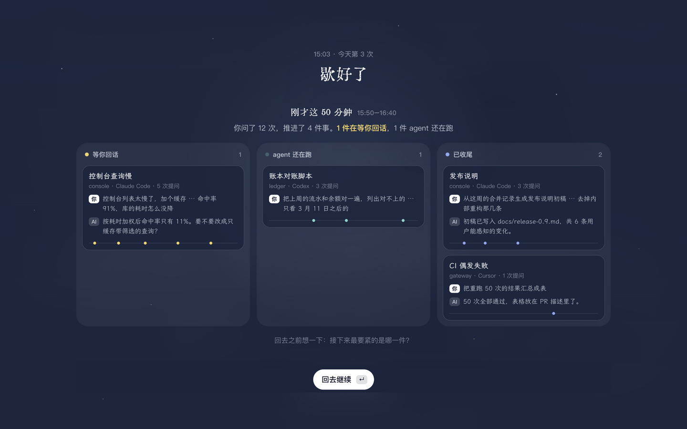
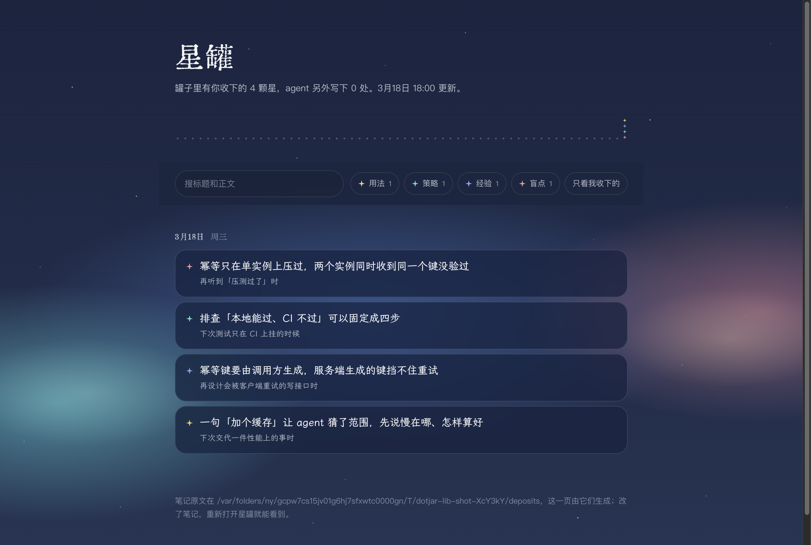

# dotjar 使用说明

中文 | [English](guide.en.md) · [回到 README](../README.md)

和 AI agent 一起干完一天的活，dotjar 把这一天铺成一条银河：告诉你 agent 哪里可以用得更顺，把**值得长期留下的策略、经验和盲点**一颗一颗捞起来，装进罐子里。在浏览器里打开就能用，也可以像一层毛玻璃那样盖在桌面上；喜欢桌宠的话，[clawd-insights](https://github.com/yx0716/clawd-insights) 里的小螃蟹会陪着你一起捞。

它不回放每段对话做了什么。它先把今天画成一条从早流到晚的星河：做了哪几件事、每件事捞到了哪几颗星、哪部分是你自己的判断，再把换个项目、过三个月还用得上的东西一张一张拿给你，问你收不收。


界面自己的大标题和题记用汇文明朝体，卡片标题、事项名和草稿正文用霞鹜文楷，按钮和标签用系统字体。两个字体都裁成了常用字的子集随项目带着，不用另外安装，也不联网。

界面跟随系统的明暗。深色是深夜；浅色是石青色的底上几大块柔光：青绿、牛仔蓝、玫瑰和一点米黄：


## 三个画面，各做一件事

- **今天**：打开先看到的一屏。宽窗口里，今天是一条横贯窗口的银河，从左边的早上流向右边的晚上；窄窗口里仍从上往下流，上游是早上。你的每一次提问是河里的一颗小星，落在提问的那个时刻；问得多的时段河面宽、光也亮，闲下来时星带收窄、变淡；河里的星尘一直沿时间方向漂，代表提问的星星不动（系统开了「减弱动态效果」时整条河静止）。做过的每件事落在开始做它的那个时刻，旁边是从这件事里捞到的星：一颗星是一条值得留下的东西，颜色是它的种类，实心发光的已经收下，空心的还等你看，略过的变成很淡的小星；同一件事的几颗星连成一个小星座。鼠标停在星上能看到种类和标题，点一下打开它（还没定的翻到那张卡片，已收下的在星罐里打开）。每件事旁边标着起止时间，写明哪个判断是你自己做的、哪个是 AI 替你做的（你可能没注意到），以及「存疑」：AI 给出但没真正验证过、值得你自己去验的结论。

  标题下面是三类对这一天的反馈：**做得好**是今天一件具体的事，写事不写评价，找不到就不写；**用上了**是模型发现今天的行为与之前收下的一条经验相符，点文字能打开那一条；**下次试试**是对着今天绕路最多的地方给的一个小动作。每行左侧可以勾选「看过了」：文字散成一小簇星光后收起，勾选只表示已读，不代表认可模型的判断。通过「已收起 · 展开」可以找回并取消勾选。状态按日期和内容保存在当前浏览器，刷新后仍在；新反馈会重新显示。开启系统「减少动态效果」时直接收起。右上角的罐子标着已经攒了多少颗。

  还没打捞时河里只有你的提问，标题上方是一行题记「维天有汉，鉴亦有光」（《诗经·小雅·大东》：天上有银河，照一照，里面也有光）。一段对话是一件事，用对话自己的标题（Claude Code 和 Codex 的记录里都有），旁边标着项目和提问次数；没有标题的对话按项目归在一起。
- **捞到的**：这一网的候选，一次一张卡片。每张是一句完整的话，附一份可以直接存成笔记的草稿，每一条都指得出今天的哪一幕；放到哪天都成立的话（「提问要具体」）不收，查到的事实、命令参数、API 细节这类「知道有这回事就行」的也不收。分四类：
  - **用法**：和 agent 配合的手法。草稿引用你当时的原话和它造成的来回，给一段下次可以直接复制去用的说法，说清 agent 当时缺的是什么；这句话如果每次都要交代，再给出可以写进 `CLAUDE.md` / `AGENTS.md` 的一两行。做得好的也会捞出来，写成「继续这样做」。一天最多两条。
  - **策略**：处理一类问题的打法。什么时候用、怎么做（每步看什么）、今天是怎么走的、什么时候不灵。验证办法也算在这里。
  - **经验**：处理这件事得到的一个判断。发生了什么、背后的道理（能画就画成一条箭头链或一个小表）、下次再遇到时先查什么、边界在哪。
  - **盲点**：思考时容易漏掉的情况。漏了什么、为什么容易漏、下次动手前问哪一句。今天真的踩到的会捞；今天没人提、但照材料看确实该考虑的也可能捞一条，会写明「还没验证」。

  按 `Esc` 回到「今天」。
- **已留下**：今天已经留下的。除了你自己收下的（星），还包括 agent 今天写进知识库、规则文件、记忆和 skill 的内容（小圆环），这部分直接从记录里读，不经过模型。点一条会在星罐里打开并定位到它。

左上角的日期点开是一张日历：有记录的日子底色深一些，写着打捞出几件事、还有几条待定、或者还没打捞。点日期去看那一天；在日子右上角打勾，可以一次打捞好几天，按日期从早到晚逐天来，每天一次模型调用。

同一天可以打捞好几次：上午捞过、下午又干了活，第一屏会提示「之后又问了 N 次，再捞一遍」，按 `R` 就行。再捞只会补上新的，已经捞到、还没定的不会被换掉，已经收下或略过的也不会再出现。

没定的候选不会因为过了一天就消失：前几天（最多 90 天）还没处理的，会一直排在「捞到的」最前面，卡片上标着是哪天留下的。想回看昨天那条河，按 `Y`。今天还没开始干活时，打开看到的是最近有活的那一天（周一早上看到的是周五），最多往回找一周。

## 歇一歇

右上角的月亮可以打开「定时歇一歇」：每隔 25 / 50 / 90 分钟，歇 3 / 5 / 10 分钟。默认是关的。



- 时间从你开始问 agent 算起。这一段里没问过 agent，不算一段工作，不会提醒；离开键盘的时间够一次休息了，算已经歇过，回来后重新计时（macOS）。到点时你刚好不在，会等你回来。
- macOS 到点时会打开独立的原生全屏提醒，覆盖各个屏幕；即使没开网页、浏览器被别的程序挡住，也能看到。复用主界面的夜空、字体和倒计时，不用额外安装 Electron。原生窗口加载失败会退回浏览器；其他系统仍用网页或浏览器通知。用毛玻璃蒙版时，蒙版会自己落下来。
- 歇到最后一分钟，下面升起刚才这一段的回顾，分三栏：**等你回话**（agent 收尾时问了你问题，或者它中途停住很久了）、**agent 还在跑**、**已收尾**。每张卡片是一段对话：你这一段开头交代的是什么、最近一句说了什么、agent 最后怎么收的尾，底下一条细线标着你的每次提问落在这一段的什么时候。倒计时结束时会刷新一次回顾，看完按 `↵` 或「回去继续」退出。读取中会显示进度，读取失败每 5 秒重试，也可手动重试；没读到不会悄悄消失。无人操作超过结束时间 30 分钟会自动收起。
- 可以「跳过」（`Esc`，不计入今天的次数，从现在重新计时），也可以「再干 5 分钟」。「现在就歇」随时可以手动来一次，不开定时也行。
- 回顾直接读本机的对话记录，不调用模型，不花钱，也不发到任何地方。

## 运行

只要有 Node（20 或更新），不用装任何依赖：

```bash
npx github:yx0716/dotjar
```

服务会在后台跑起来，页面在浏览器里打开，终端可以直接关掉。第一次用终端里打印的带授权的地址打开，之后收藏 `http://127.0.0.1:4747/` 就行。停掉：

```bash
npx github:yx0716/dotjar stop
```

想以后直接敲 `dotjar`，装成全局命令：

```bash
npm install -g github:yx0716/dotjar
```

想连这条命令都不用再跑（macOS），先像上面那样装成全局命令，再：

```bash
dotjar service install
```

装一次，以后登录就自动启动，只用开收藏夹。取消是 `dotjar service uninstall`。（通过 `npx` 也能装自启，但它指向 npx 的缓存目录，缓存被清掉就失效了。）

从源码跑也一样：克隆仓库后 `npm start`，对应的还有 `npm run stop`、`npm run service`、`npm run service:off`。dotjar 的代码更新以后，页面底部会提示后台服务还是旧的，点「重启服务」就换成新的；再启动一次也会自动换。

它为什么不是一个双击就能开的纯网页：它要读本机各个 agent 的记录，还要把笔记写进文件夹，浏览器里的页面自己做不到这两件事，所以后面得有一个只监听本机（`127.0.0.1`）的小服务。

想先看看样子、不读任何本机数据：

```bash
npx github:yx0716/dotjar demo
```

今天还没有任何对话时，页面上也有一个「先看看演示的一天」。

| 按键 | 作用 |
|---|---|
| `1` `2` `3` | 切到「今天」「捞到的」「已留下」 |
| `←` `→` | 翻看候选。也可以在触控板上左右滑、点卡片两侧的箭头或右上角的小星；先看一遍再决定，不用一条条处理完 |
| `↵` | 收下：把草稿写成一篇 Markdown，星星飞进罐子 |
| `⌫` | 略过：以后的打捞不再提它 |
| `Z` | 撤销上一步 |
| `C` | 复制草稿 |
| `R` | 再捞一遍 |
| `L` | 打开星罐 |
| `Esc` | 从卡片或列表回到「今天」；歇一歇时是跳过 |
| `Y` | 在今天和昨天之间切换。更早的日子点左上角的日期，用日历选 |
| `E` | 换一个来打捞：本机的 Claude、本机的 Codex、或你配置的接口 |
| `⌘V` | 把剪贴板里的文字存进今天的材料 |

### 也可以铺成桌面上的一层毛玻璃（可选）

同一套界面还能作为蒙版盖在桌面上，按快捷键落下、失焦收起。这需要克隆仓库并装上 Electron：

```bash
npm install
```

```bash
npm run veil
```

蒙版多两个全局快捷键：`⌥⇧S` 落下 / 收起，`⌥⇧C` 在任何应用里把剪贴板存进今天的材料。收起之后应用还在运行，按 `⌥⇧S`、点 Dock 里的图标、点菜单栏的图标、或再跑一次 `npm run veil` 都能叫回来；退出用 `⌘Q`。用这种方式运行时，Dock 里的名字会显示成 Electron，图标是 dotjar 的。网页和蒙版可以同时开着，用的是同一份数据。

## 留下的东西存在哪

每收下一条，就在笔记文件夹里多一篇普通的 Markdown，默认是 `~/.dotjar/deposits/`。不需要 Obsidian，也不依赖任何笔记软件；在卡片右下角点「换位置」可以改成任意文件夹，比如你自己的笔记目录或 Obsidian 库的收件箱。

### 星罐：所有笔记合成的一个网页



按 `L`，或点右上角的罐子，会在浏览器里打开 `~/.dotjar/library.html`。它是一个不联网的单文件网页，由笔记文件夹里的 Markdown 生成：按天排列，可以搜索、按种类筛选、点开看全文。你收下的是星；agent 自己写进笔记、规则文件、记忆和 skill 的内容也一样是卡片，标记是空心的小圆环：当天新建的文件点开是全文，往已有文件里补的只显示当天补进去的那几节；只往索引页加了一行链接的不算。在网页版里，每张卡片展开后可以「移出」：你收下的笔记挪进 `~/.dotjar/trash`，候选记为略过；agent 写的只是不再显示，原文件不动；都能马上撤销。每次收下、撤销和打开时都会重新生成，Markdown 始终是唯一的数据源，直接改笔记就行。

不开界面也能生成：

```bash
dotjar library
```

## 今天的材料从哪来

1. **本机所有 agent 的对话记录**。只取你说的话和 agent 每轮的收尾消息；工具调用、工具输出、定时任务、其他工具发起的无人值守会话，以及对话太长时 agent 自动写的前情摘要，都不读。界面底部那行小字会写明今天读到了哪些 agent、各几段。

   | agent | 读取位置 |
   |---|---|
   | Claude Code | `~/.claude/projects` |
   | Codex | `~/.codex/sessions` |
   | Cursor | `~/.cursor/projects/*/agent-transcripts` |
   | OpenClaw | `~/.openclaw/agents/*/sessions` |
   | Gemini CLI、Qwen Code | `~/.gemini/tmp/*/chats`、`~/.qwen/tmp/*/chats` |
   | opencode | `~/.local/share/opencode/storage` |
   | CodeBuddy、Claude Internal、tclaude | `~/.codebuddy/projects` 等（与 Claude Code 同一种格式） |

2. **你手动存入的文字**。在豆包、网页、任何应用里复制一段，回到页面按 `⌘V`（用蒙版时在任何应用里按 `⌥⇧C` 即可），或者把导出的对话、会议纪要放进 `~/.dotjar/inbox/`。没有本地记录的工具走这条路。

## 用哪个模型打捞

三种可选。不用配置：装了 `claude` 就用它，没有就用 `codex`，都没有再看有没有配接口。机器上不止一个可用时，右上角点一下（或按 `E`）就能切换，选过之后记住你选的：

- **本机的 Claude**：调用 `claude` 命令，不给工具、不留会话记录。
- **本机的 Codex**：调用 `codex exec`，只读、不联网搜索、不留会话记录。
- **任意 OpenAI 兼容的接口**：公司的模型网关、豆包（火山方舟）、DeepSeek、本地的 Ollama。两个命令都装不了的环境用这个，编辑 `~/.dotjar/config.json`：

```json
{
  "engine": "openai",
  "api": {
    "baseUrl": "https://ark.cn-beijing.volces.com/api/v3",
    "model": "你的模型或接入点 ID",
    "apiKeyEnv": "ARK_API_KEY"
  }
}
```

密钥可以放在 `apiKeyEnv` 指向的环境变量里，也可以直接写在 `api.apiKey`。材料只发往你选的这一个。打捞一天是一次模型调用。

## 其他配置

都在 `~/.dotjar/config.json`，改完重启生效：

| 键 | 含义 | 默认 |
|---|---|---|
| `language` | 界面语言：`zh`、`en`，或 `auto` 跟随系统。收下的笔记和星罐用同一种语言 | `auto` |
| `wording` | 「留下」这件事叫什么。整套界面用词跟着换：`打捞`（收下 / 星罐）、`落库`（待落库 / 库存）、`落袋`（待落袋 / 口袋）、`归仓`（待归仓 / 谷仓）、`攒`（值得攒 / 家底）、`带走`（能带走 / 背包）、`存档`（待存档 / 档案） | `打捞` |
| `rest` | 定时歇一歇：`{ "enabled": false, "everyMin": 50, "forMin": 5 }`。界面里也能改；这里可以填界面上没有的分钟数 | 关 |
| `hotkey` | 落下 / 收起蒙版 | `Alt+Shift+S` |
| `captureHotkey` | 把剪贴板存进今天的材料 | `Alt+Shift+C` |
| `dayStartHour` | 一天从几点算起，凌晨的工作算前一天 | `4` |
| `engine` | 谁来打捞：`auto`（装了哪个用哪个）、`claude-cli`、`codex-cli`、`openai`。界面里也能切 | `auto` |
| `model` | 传给 `claude --model` | `sonnet` |
| `codexModel` / `codexEffort` | 传给 Codex 的模型（留空用它自己的默认）和思考强度 | 空 / `low` |
| `depositDir` | 笔记文件夹 | `~/.dotjar/deposits` |
| `noteDirs` | 除 Obsidian 库之外，还有哪些文件夹里的 `.md` 算 agent 写下的笔记 | `[]` |

界面上所有的字都在 `src/overlay/words.js` 里，中英各一份；想加一套自己的说法，照着加一组即可。

## 命令行

不开界面也能用，方便检查它看到了什么、会发出去什么（从源码跑时把 `dotjar` 换成 `node bin/dotjar.js`）：

```bash
dotjar scan
```

```bash
dotjar prompt
```

```bash
dotjar distill
```

## 数据放在哪

全部在 `~/.dotjar/`（可用环境变量 `DOTJAR_HOME` 改）：

- `days/2026-10-13.json`：每天一个台账，记着候选、你的决定、这一天的反馈、agent 当天写下了什么
- `deposits/`：你留下的 Markdown
- `library.html`：星罐
- `trash/`：网页版里撤销收下时，笔记挪到这里（蒙版里是移进系统废纸篓）
- `rest.json`：今天歇了几次、上一次歇到几点
- `web-token`：网页版的授权
- `inbox/`：手动存入的材料
- `config.json`

## 已知的边界

- 每颗星挂在哪件事旁边，是模型打捞时标的。标不出来的按文字相近程度推断，可能挂错；推断不出来的放在河的末尾。起止时间也是模型照着对话时间估的；还没打捞时，用的是每段对话第一次和最后一次提问的时间。
- 「用法」的建议只根据你说的话和 agent 的收尾消息，看不到 agent 中间调用了什么工具，所以它不评价 agent 中间做得对不对。
- 「做得好」「用上了」是模型写的。「用上了」只认你真的收下过的标题，别的会被丢掉；「做得好」没有这层校验，觉得不对就当它没说。
- 以前的三类候选（心得 / 规则 / 流程）和已经存下的笔记照常显示，颜色并到相近的新种类里；以后的打捞只出四类。桌宠要更新后才认得新种类的颜色，在那之前新种类一律显示成蓝色。
- 歇一歇的「agent 还在跑」，Claude Code 和 Codex 是照记录里的「这一轮结束了没有」判断的；其他 agent 的记录里没有这个标记，只能按有没有收尾消息来猜，可能把中途的一句话当成收尾。
- 在浏览器里，歇一歇没办法像原生应用那样盖住整个屏幕：页面开在后台又没给通知权限时，只能把页面带到最前面（多开一个标签页，歇完会试着自己关掉）。想要盖住整个屏幕的效果，用毛玻璃蒙版。蒙版里的歇一歇是照着网页版写的，还没有在 Electron 里实际跑过。
- 离开键盘多久只在 macOS 上读得到；其他系统上歇一歇只看时间和有没有问过 agent。
- Claude Code、Codex、OpenClaw 用真实记录验证过，Cursor 用本机的旧记录核对过格式；Gemini CLI、Qwen Code、opencode、CodeBuddy 这台机器上没有数据，只按它们的文件格式写了测试。
- Cursor 的记录里每条消息没有时间，今天之前开始的会话只取最后几轮。
- agent 写下的东西靠它的写文件记录识别。用 shell 命令改的笔记（比如 `cat >>`）读不到；打捞时会参考 agent 说过的「已归档」来避免重复，但「已留下」里不会出现这篇笔记。
- agent 写的笔记只认 Obsidian 库（目录里有 `.obsidian`）和 `noteDirs` 里配置的文件夹。不用 Obsidian 的话，把自己的笔记目录填进 `noteDirs`。规则文件、记忆和 skill 的识别与此无关。
- 一天的材料超过约 9 万字时，长会话只保留开头和结尾的几轮。
- 随项目带的霞鹜文楷只有 GB2312 的 6763 个常用字，更生僻的字由系统字体显示，夹在一行里字形会不一样；本机装了完整的霞鹜文楷就不会。汇文明朝体会把「让、认、论、证、讲」等字画成像别的字的旧字形，所以只用在界面自己的标题上，这些字交给霞鹜文楷。授权和重新裁剪的办法见 `src/overlay/fonts/README.md`。
- 毛玻璃用的是 macOS 的系统材质；Windows 用 acrylic，Linux 上只有半透明的色层。目前只在 macOS 上跑过。

## 开发

```bash
npm test
```

```bash
npm run shot
```

`npm run shot` 用演示数据渲染一张截图到 `shots/veil.png`，全程不显示窗口；加 `-- --lang=en`、`-- --theme=dark`、`-- --view=open`、`-- --demo-state=rest` 可以看其他状态。不装 Electron 也能看演示：直接在浏览器里打开 `src/overlay/overlay.html`，地址后面加 `?state=rest`、`?state=fresh`、`?view=open`、`?lang=en`。代码结构：

- `src/core/sources.js` 读当天的记录（Claude Code、Codex、手动存入）
- `src/core/agents.js` 其他本地 agent 的读取
- `src/core/durable.js` 判断一个文件算不算长期留下的东西、算哪一类
- `src/core/day.js` 汇总 agent 写下的文件，压缩出交给模型的材料
- `src/core/distill.js` 打捞的提示词和三种引擎
- `src/core/rest.js` 歇一歇的计时，和一段时间的回顾
- `src/core/ledger.js` 台账与存档
- `src/core/library.js` 星罐网页
- `src/core/session.js` 界面能发起的全部操作，与由谁承载无关
- `src/overlay/` 界面（纯 HTML / CSS / JS）
- `src/main.js` 桌面外壳：蒙版窗口、Dock、菜单栏、快捷键，通过 IPC 把界面接到 session
- `src/server.js` 本机网页服务，通过 HTTP 把同一个界面接到 session

界面只有一份，承载它的方式有两种：桌面外壳把它铺成一层系统级的毛玻璃，网页服务把它放进浏览器。网页服务只监听 `127.0.0.1`，每个请求都要带 `~/.dotjar/web-token` 里的授权（首次打开时换成浏览器 cookie），别的网站和同一台机器上的其他用户都调不到它。

## 许可证

MIT，见 [LICENSE](../LICENSE)。
